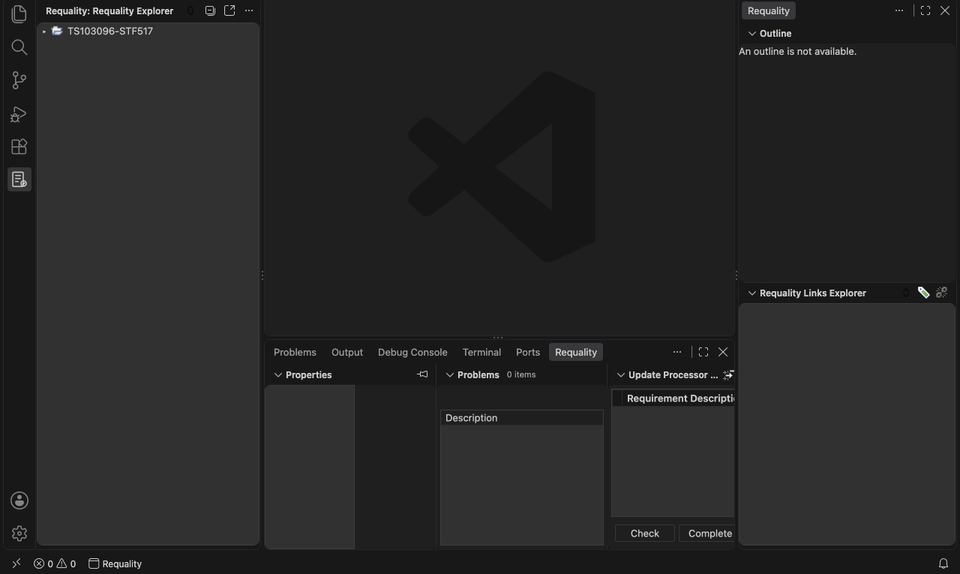
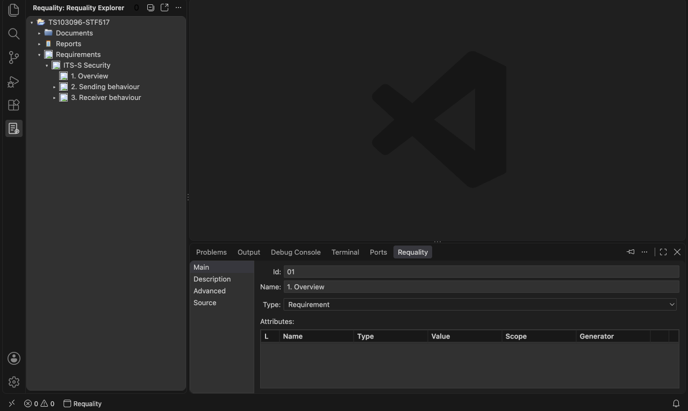
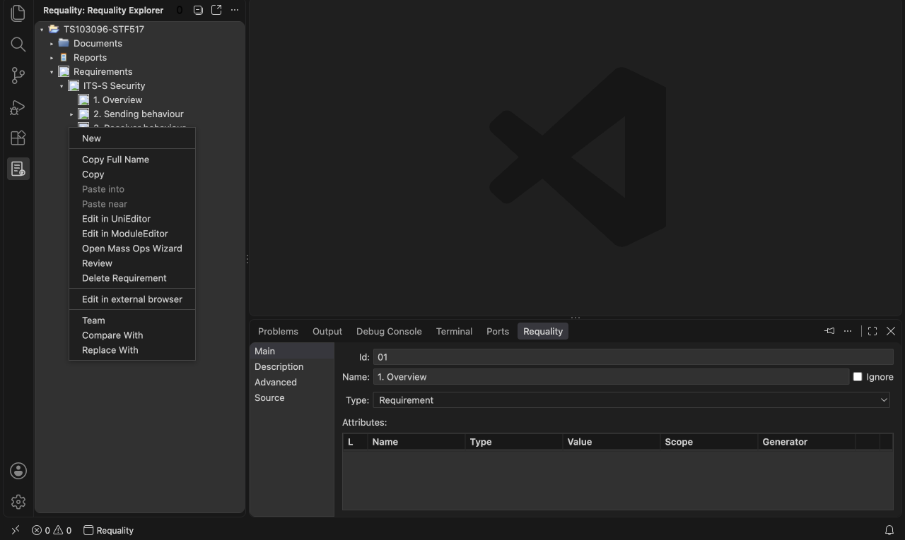
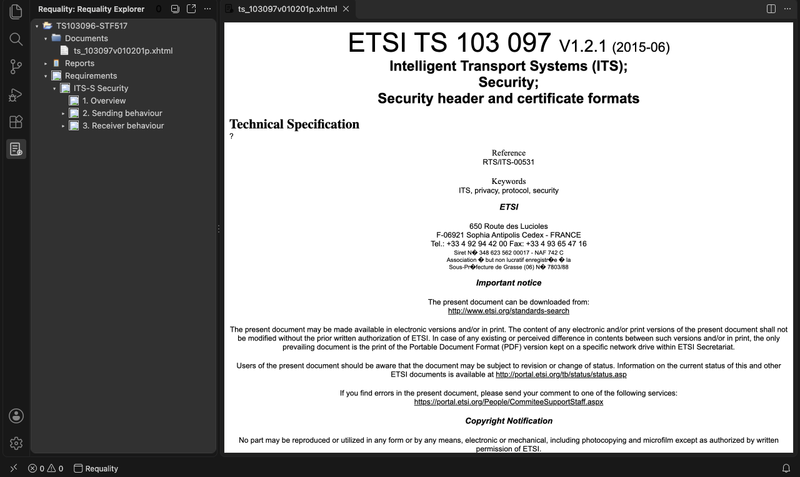
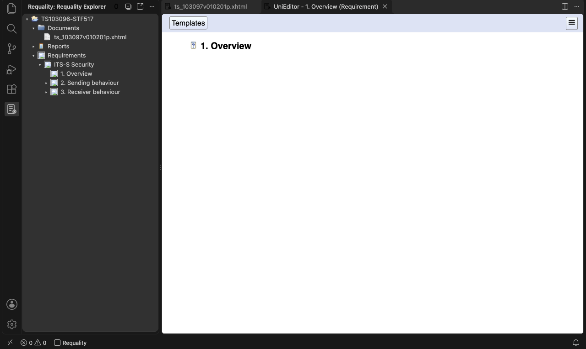

# Requality for VS Code (Unofficial)

[](https://marketplace.visualstudio.com/items?itemName=formalized-si.requality-vscode)
[](https://marketplace.visualstudio.com/items?itemName=formalized-si.requality-vscode)
[](https://open-vsx.org/extension/formalized-si/requality-vscode)
[](https://github.com/formalized-si/requality-vscode/actions/workflows/ci.yml)
[](#license)

Requality for VS Code is a port of the Requality Eclipse plug-in (branch `unstable`) to Visual Studio Code.
Requality is a tool for requirements management ([requality.org](http://requality.org)).
The extension uses the original Requality core and the original user interface code of the Eclipse plug-in.

> **Unofficial port.** ISP RAS develops Requality. This extension is not a product of ISP RAS.
> formalized.si made the port from the Requality source code that ISP RAS published under the Apache License 2.0.



## Two ways to use Requality

- **In VS Code:** the views, editors and wizards of the Eclipse plug-in (refer to [Features](#features)).
- **Without a window:** an MCP server for the AI agents on your computer (Claude Code, Codex, Cursor and others).
  You give the jobs to the agent, and the agent uses Requality. Refer to
  [Requality without a window (MCP server)](#requality-without-a-window-mcp-server).

## Features

- The Requality Explorer is the view of the Eclipse plug-in, with its tree, its popup menu and its keys.
  
- The popup menu has the actions of the plug-in: New, Copy Full Name, the editors, Team, Compare With and others.
  
- The Document Editor shows a document and the requirement locations in it.
  
- The UniEditor and the ModuleEditor edit the requirements. Review, the reports and the wizards are also available.
  
- The Properties, Outline, Links Explorer, Bookmarks, Tasks, History, Synchronize, Problems and Progress views
  are the Eclipse views.
- The packages for Windows, Linux and macOS contain a Java runtime. You do not have to install Java.
- An AI agent can use Requality without a window. Refer to [Requality without a window (MCP server)](#requality-without-a-window-mcp-server).

## How the port works

- The extension starts a Java server. The server contains the Requality core and all 320 classes of the plug-in.
- The port retains the upstream plug-in classes, with adapted package names and imports, compatibility fixes and
  changes needed for headless execution.
- A compatibility layer in the server implements the Eclipse APIs that the plug-in uses.
  These APIs are SWT, JFace, workbench, navigator, resources, team, commands, compare and LTK.
- The server reads `plugin.xml` as Eclipse does.
  Commands, menus, wizards, property pages, decorators, perspectives and other contributions come from this file.
- The extension shows the SWT controls of the server in VS Code webviews.
- For the parity report of each class, refer to [docs/PARITY.md](docs/PARITY.md).

## Requirements

- VS Code 1.95 or later.
- Java: the packages for Windows, Linux and macOS (x64 and Arm) contain a Java 21 runtime.
  On other platforms, the extension uses Java 17 or later. It uses the first Java that it finds:
  1. The `requality.java.home` setting.
  2. The Java runtime in the package.
  3. The `JAVA_HOME` environment variable.
  4. The `java` command on the `PATH`.
- Optional: LibreOffice, for the import and the update of documents (setting `requality.libreOfficePath`).
- Optional: ImageMagick (setting `requality.imageMagickPath`).

## Install

Install the extension **Requality (Unofficial)** from the Visual Studio Marketplace or from Open VSX.
Versions with an odd minor number (for example, 1.5) are pre-releases.
To get them, click **Switch to Pre-Release Version** on the page of the extension in VS Code.

To install a VSIX file (for example, from the GitHub releases):

1. In VS Code, open the Command Palette.
2. Run the command **Extensions: Install from VSIX...**.
3. Select the VSIX file.

## Start

1. Open a folder that contains Requality catalogs.
   A Requality catalog is a folder with a `.project` file of the Requality nature.
2. Click the **Requality** icon in the activity bar.

The extension starts the Requality server.
The **Requality** side bar and the **Requality** panel show the views of the Requality perspective.

## Requality without a window (MCP server)

In VS Code, run **Requality: Connect AI Agent (MCP)...** to prepare a configuration for Codex, VS Code,
Claude Code, Claude Desktop or Cursor. It uses the Java runtime of the extension and all open local workspace
folders. Review the configuration in the editor and copy it into the agent's settings. Close the catalog in
Requality before using it from the agent; only one process can open it at a time.

The Requality MCP server is Requality without a window, for AI agents on your computer (Claude Code, Codex, Cursor
and others). The agent starts the server and uses its tools through the Model Context Protocol.
The tools follow the jobs of a requirements engineer:

- turn a specification into requirements with document locations;
- move the traceability to a new version of a specification;
- show the coverage by document text and by tests;
- show the changes of the agent for a review, with undo and revert, and compare a catalog with a Git revision.

The agent also imports ReqIF files, changes the project settings (attributes, enumerations, mandatory attributes,
checker rules) and makes the reports.

The installers and the archives come with the releases from version 1.5.0. To install on macOS or Linux (the script
downloads the archive with a Java runtime from the GitHub releases):

```
curl -fsSL https://raw.githubusercontent.com/formalized-si/requality-vscode/main/scripts/install-mcp.sh -o install-mcp.sh
sh install-mcp.sh
claude mcp add requality -- ~/.local/bin/requality-mcp /path/to/catalogs
```

The script verifies the build provenance attestation of the archive with the GitHub CLI (`gh auth login`); without
`gh`, set `REQUALITY_MCP_UNVERIFIED=1` to install with the SHA-256 check only.
On Windows, use `scripts/install-mcp.ps1`. Before version 1.5.0 is released, build the server from the source code
(refer to [docs/MCP.md](docs/MCP.md#install)). From version 1.5.0, the VS Code extension contains the same server:
`dist/server/bin/requality-mcp`.

- Only one Requality process can open a catalog at a time. Two sessions of the agent take turns: an idle session
  releases a catalog when the other one needs it. VS Code keeps a catalog until you close it there.
- The agent can import files and write reports only in the folders of the catalogs, in the `--allow` folders and in
  the folders that you allow when the agent asks.
- A catalog of an older Requality is converted only after a backup (`convert_project`).

Refer to [docs/MCP.md](docs/MCP.md) for the other agents, the tools, the options and the features that need a window.

## Eclipse views in VS Code

| Eclipse | VS Code |
| --- | --- |
| Requality Explorer | The **Requality Explorer** view. Refer to [Requality Explorer](#requality-explorer). |
| Properties | The **Properties** view in the panel. It has the original tabs and sections, and **Pin to Selection**. |
| Outline | The **Outline** view. It shows the outline page of the active editor. |
| Requality Links Explorer | The **Requality Links Explorer** view. |
| Update Processor Tasks | The **Update Processor Tasks** view in the panel. |
| Bookmarks, Tasks | The **Bookmarks** and **Tasks** views in the panel. The view menu is the `...` menu of each view. |
| History | The **History** view in the panel. You can drop files on this view. |
| Synchronize | The **Synchronize** view in the panel, with its participants, **Synchronize with Patch** and **Link with Editor**. |
| Problems | The **Problems** view in the panel. The extension also shows the problem markers as VS Code diagnostics. |
| Progress | The **Progress** view in the panel, and an item in the status bar. Click the item to open the view. |
| Document Editor, UniEditor, ModuleEditor, Review, Report Viewer | Editor tabs with the original web editors. |
| Dialogs, wizards, preference pages, property pages | Editor tabs with the original SWT dialogs. |
| Compare editor | The VS Code diff editor for text. An editor tab for the other compare viewers of Eclipse. |
| Help Contents | The command **Requality: Requality Manual**. It opens the manual with its contents, search and bookmarks. |
| Window > Preferences | The command **Requality: Preferences**. |
| Error Log | The command **Requality: Show Server Log**. |
| Quick Access, Keys | The Command Palette and the VS Code keyboard shortcuts. |

## Requality Explorer

The Requality Explorer shows the projects of the workspace and the nodes of the Requality catalogs.
The setting `requality.explorer.view` selects one of two modes:

- `eclipse` (default): The server shows the view part of the plug-in (RequalityCNF) in the VS Code view.
  The tree, the popup menu, drag and drop and the keys operate as in Eclipse.
- `native`: A VS Code tree shows the same items. The context menu has the same commands.

When you change this setting, the extension restarts the server.

### Context menu

The context menu has the items of the Requality action providers and of `org.eclipse.ui.navigator.resources`:

- **New**. For nodes, this menu has the Requality node types.
  For projects, folders and files, it has **Project...**, **Folder**, **File** and **Other...**.
- **Go Into**, **Open**, **Open With** and **Show In**.
- The Requality actions: edit, generate, documents, **Checkers**, **Transferred status** and **Import Document...**.
- **Copy**, **Paste**, **Delete**, **Move...** and **Rename...**.
  For projects, folders and files, these items open the LTK dialogs with **Preview >**.
- **Import**, **Export**, **Import as Project** and **Refresh**.
- **Open Project**, **Close Project**, **Close Unrelated Projects** and **Build Project**.
- **Team**: **Apply Patch...**, **Show Local History** and **Share Project...**.
- **Compare With**: **Each Other**, **Local History...** and **Clipboard**.
- **Replace With**: **Local History...**, **Previous from Local History** and **Clipboard**.
- **Restore from Local History...**, **Import Project Set...**, **Configure** and **Properties**.

### View toolbar

- **Back**, **Forward** and **Up**. These buttons are visible after you use **Go Into**.
- **Select Referenced Node**.
- **Collapse All**.
- **Link with Editor**.

### View menu

The `...` menu of the view contains these items:

- The working set items. These are **Select Working Set...**, **Deselect Working Set**, **Edit Active Working Set...**,
  the recent working sets and **Top Level Elements**.
- **Filters and Customization...** and **Recent Filters**.
- The Eclipse main menus: **File**, **Edit**, **Navigate**, **Project**, **Window** and **Help**.

### Drag and drop

- Drag nodes onto a node to move them into that node.
- Hold Shift when you drop nodes to put them after the target node.
- Hold Ctrl when you drop nodes to reuse them in the target node.
- Drag projects, folders and files onto a project or a folder to move them.
- Hold Ctrl when you drop resources to copy them.
- Drag files from the VS Code Explorer or from the operating system onto a project or a folder.

In the `native` mode, VS Code does not give the modifier keys of a drop.
After the drop, select the type of drop in the list.

### Keys

| Key | macOS | Command |
| --- | --- | --- |
| Ctrl+R | Cmd+R | Opens the bindings popup. Then one key creates a node, as in Eclipse. |
| F2 | F2 | Rename |
| Delete | Cmd+Backspace | Delete |
| Ctrl+C | Cmd+C | Copy |
| Ctrl+V | Cmd+V | Paste |
| F5 | F5 | Refresh |
| Ctrl+Z | Cmd+Z | Undo |
| Ctrl+Y | Cmd+Shift+Z | Redo |
| Ctrl+B | Cmd+B | Build All |
| Ctrl+F | Cmd+F | Find/Replace |
| Ctrl+N | Cmd+N | New |
| Alt+Enter | Alt+Enter, Cmd+I | Properties |
| Alt+Shift+W | Alt+Shift+W | Show In |

The keys run the Eclipse commands. The server selects the handler of a command as Eclipse does.
Undo and Redo operate on the node operations and on the resource operations.

## Workspace

- The Eclipse workspace is the VS Code workspace.
- The projects are the folders with a `.project` file in the workspace folders.
- New projects go into the first workspace folder.
- The VS Code workspace storage keeps the data of the Eclipse `.metadata` folder.
  This data contains closed projects, external projects, the build state, the local history and the working sets.
- The navigator preferences are the VS Code settings `requality.explorer.*`.

## Perspectives

At startup, the extension opens the Requality perspective.
The layout of a perspective puts each view into a VS Code container:

| Place in the perspective | VS Code container |
| --- | --- |
| Left of the editor area | The primary side bar |
| Right of the editor area | The secondary side bar (VS Code 1.106 and later). The primary side bar in earlier versions. |
| Above or below the editor area | The panel |

The extension uses the layout when you open a perspective for the first time.
It also uses the layout when you reset the perspective. After that, you can move the views.

**Window > Perspective** has these items:

- **Open Perspective**
- **Customize Perspective...**
- **Save Perspective As...**
- **Reset Perspective...**
- **Close Perspective** and **Close All Perspectives**

The status bar shows the current perspective. Click it to open the **Open Perspective** dialog.

## Differences from the Eclipse workbench

- **Main menu.** VS Code does not let extensions add menus to its menu bar.
  The Eclipse main menus are submenus of the `...` menu of the Requality Explorer.
  The Command Palette also contains their commands.
- **Window title.** The extension sets the title of the VS Code window as Eclipse calculates it.
  The extension does not change a title that you set in the `window.title` setting.
  To stop this function, set `requality.window.title` to `false`.
- **Focus of views.** VS Code does not set the `focusedView` context key for a webview view.
  The server views set the context key `requality.focusedView`. The keys of the Requality Explorer use this key.
- **Open With.** The list contains the Requality editors, the VS Code text editor, the custom editors of VS Code
  extensions and the system editor. **Other...** opens the Eclipse **Editor Selection** dialog.
- **Show In.** **Project Explorer** is the VS Code Explorer. **System Explorer** is the file manager.
  **Terminal** is the VS Code terminal.
- **Compare.** The VS Code diff editor shows the comparisons of text. You can edit and save workspace files in it.
  The other comparisons open in an editor tab with the panes of the Eclipse compare editor.
- **Local history.** When you save a file in a VS Code editor, its old contents become a local history state.
  The Eclipse limits are 7 days, 50 states for each file, and files of 1 MB or less.
- **Preferences.** The open mode of the General page is the VS Code setting `workbench.list.openMode`.
  VS Code settings replace the Eclipse pages for appearance, colors, fonts, keys, editors and content types.
- **Team.** The Requality product does not install a repository provider such as CVS, SVN or Git.
  The Team wizards show no repository types, as in Eclipse. For Git, use the source control of VS Code.
- **Drop into webviews.** VS Code drops files from its views into a webview only when you hold Shift.
- **Show View keys.** Alt+Shift+Q Q opens a view. Alt+Shift+Q X, O, Y and Z show Problems, Outline, Synchronize and History.
  On macOS, use Cmd+Alt+Q.
- **Windows.** The plug-in reads the Long Paths value of the registry and shows its warning.
  The plug-in does not show the connection limit warning of Internet Explorer. The web editors use Chromium webviews.

## Settings

| Setting | Function |
| --- | --- |
| `requality.java.home` | The Java runtime for the server. |
| `requality.server.maxHeap` | The maximum Java heap of the server (`-Xmx`). The default is `2g`. |
| `requality.libreOfficePath` | The LibreOffice `soffice` program. |
| `requality.imageMagickPath` | The ImageMagick program. |
| `requality.globalCacheLocation` | The global cache location. |
| `requality.debugLevel` | The debug level of the core. |
| `requality.explorer.view` | The mode of the Requality Explorer: `eclipse` (default) or `native`. A change restarts the server. |
| `requality.explorer.linkWithEditor` | **Link with Editor** of the Requality Explorer. |
| `requality.explorer.filters` | The pre-set filters of **Filters and Customization**. |
| `requality.explorer.userFilters` | The user filters of **Filters and Customization**. |
| `requality.explorer.contentExtensions` | The content of **Filters and Customization**. |
| `requality.window.title` | Use the Eclipse title for the VS Code window. The default is `true`. |

**Requality: Preferences** shows the Requality preference pages. The server keeps these preferences as Eclipse does.

## Build

1. Install Node.js 22.
2. Install a JDK 17 or later.
3. Run `npm ci`.
4. Run `npm run build`. This command builds the server into `dist/server` and compiles the extension.
5. Run `npm run package`. This command makes the file `requality-vscode-1.5.0.vsix` without a Java runtime.
6. To make the packages of a release, run `npm run package:platforms`.
   This command makes one VSIX file for each platform with a Java runtime, and one without, in `release/`.
7. To make the archives of the MCP server, run `npm run package:mcp`.
   This command makes one archive for each platform with a Java runtime, and one without, in `release/`.

The workflow `.github/workflows/release.yml` makes a release for a tag `v<version>`.
It publishes the packages to the Visual Studio Marketplace (secret `VSCE_PAT`) and to Open VSX (secret `OVSX_PAT`).
If the minor number of the version is odd, the packages and the GitHub release are pre-releases.

## Test

| Command | Tests |
| --- | --- |
| `npm run test:server` | The Java tests of the server. |
| `npm run test:unit` | The unit tests of the renderer and of the extension. |
| `npm run test:integration` | The tests of the extension in a VS Code that the test downloads. |
| `npm run test:mcp` | The test of `dist/server/bin/requality-mcp`: its options, and two sessions of an agent (a change of the first session is reverted in the second one). |
| `npm test` | All the tests above. |

- The server tests download the public ETSI TS 103 096 catalog into `server/build/test-catalogs`.
- To select the VS Code version, set `VSCODE_TEST_VERSION`, for example to `1.95.0`.
- To test a VSIX file, extract it. Then set `REQUALITY_IT_EXTENSION_PATH` to `<folder>/extension`.
- To keep the full log of the extension, set `REQUALITY_IT_LOG` to a file name.
- The integration tests use the `native` mode first. Then they use the `eclipse` mode and push keys in its webview.
- The CI workflow (`.github/workflows/ci.yml`) runs the tests on Linux and on Windows.
- `npm run media` makes the pictures of this file (`media/readme`) with the ETSI catalog.

### Windows registry test

The server reads the Windows registry with the `reg` tool.
On other systems, a test program gives the output of `reg`.
On Windows, the test uses the `reg` tool. It compares the value with the value that PowerShell reads.
To use a different `reg` program, set two properties. This example uses the `reg.exe` of Wine:

```sh
cd server
./gradlew test --rerun --tests '*WindowsRegistryTest' -Drequality.test.reg=/path/to/wine-reg.sh -Drequality.test.reg.longPaths=0
```

The value of `requality.test.reg.longPaths` is the value of `LongPathsEnabled` in that registry.

### Messages of the ETSI catalog

The server log shows `NodeNotFoundException` messages for the ETSI catalog.
15 nodes of the catalog refer to an origin node that the catalog does not contain.
The Requality core does not load these nodes. The catalog data causes these messages.

## Repository layout

| Path | Content |
| --- | --- |
| `src/` | The extension: the server connection, the views, the webview hosts and the VS Code commands. |
| `media/rswt/` | The renderer of the SWT controls in webviews. |
| `server/upstream/` | The upstream Requality code: core, web editors, templates, icons and the Eclipse plug-in sources. |
| `server/src/main/java/.../vscode/port/` | The ported Eclipse plug-in classes. |
| `server/src/main/java/.../vscode/ui/` | The compatibility layer: SWT, JFace, workbench and the other Eclipse APIs. |
| `server/src/main/java/.../vscode/services/` | The JSON-RPC services of the server. |
| `server/src/main/java/.../vscode/mcp/` | The headless server and its MCP server (tools for AI agents). |
| `scripts/` | The tools for the port, and the generators of the manifest and of the parity report. |
| `docs/` | `MCP.md`, `PARITY.md` (generated), `PORTING-GUIDE.md` and `command-map.json`. |

## License

The extension has the MIT license (`LICENSE`).
The Requality core, the web editors and the ported plug-in code have the Apache License 2.0.
Refer to `server/upstream/LICENSE.txt`. The VSIX contains this file as `dist/server/LICENSE-requality-upstream.txt`.
The packages for Windows, Linux and macOS contain the Eclipse Temurin Java runtime.
It has the GNU General Public License, version 2, with the Classpath Exception. Its license files are in `jre/legal`.
